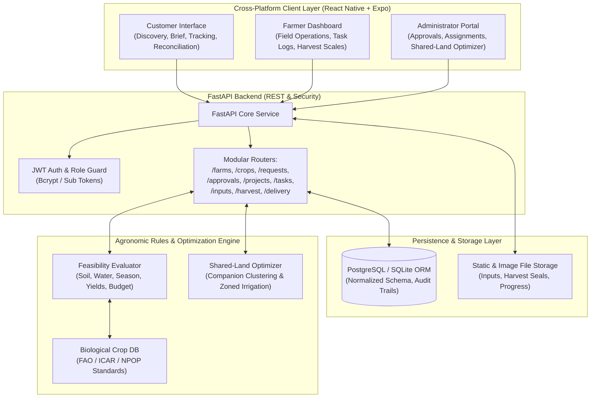
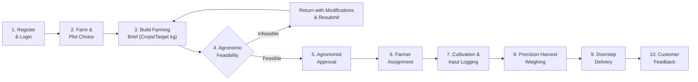

# Rent-a-Farm — System Architecture & Flowchart

**Tagline:** *Your Land. Your Crops. Your Harvest.*  
**Domain:** Agritech Service Platform (Personalized Organic Farming as a Service)

---

## 1. High-Level Architecture Overview

Rent-a-Farm bridges urban consumers with verified agricultural landowners, farmers, and certified agronomists through a unified 3-role ecosystem:

---

## 2. Core 10-Step Traceable Lifecycle Flowchart

The application enforces a strictly traceable, sequential workflow:

---

## 3. The 3 Distinct Roles & Permission Boundaries

| Role | Permitted Actions | Boundaries |
| :--- | :--- | :--- |
| **Customer** | • Browse organic farms & available plots • Submit custom farming briefs & target yields • Review scientific feasibility assessment • Track 10-stage cultivation lifecycle • Inspect organic input records & receipts • Access harvest reconciliation and variance • Rate experience and produce quality | Restriced to their own farm projects and requests. Cannot approve plans, reassign farmers, or modify field logs. |
| **Farmer** | • View assigned plots and customer requirements • Execute sequential operational field tasks • Log agricultural inputs (with organic verification) • Record calibrated digital harvest scale weights • Review itemized compensation balance and payouts | Restriced to authorized farm assignments. Cannot modify rental rates or override agronomic feasibility rules. |
| **Administrator / Agronomist** | • Ecosystem dashboard and farm estate onboarding • Review submitted briefs & feasibility reports • Approve or reject cultivation plans with notes • Assign qualified farmers based on workload • Run Shared-Land Optimization engine • Reconcile harvested weights & dispatch delivery | Platform-wide management and governance across all users, farms, and audit logs. |
