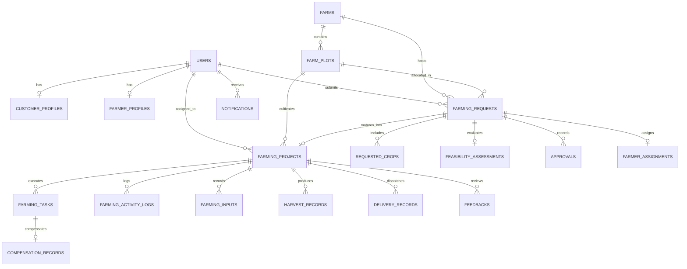

# Database Schema & Entity Relationships

The Rent-a-Farm persistence layer uses a normalized relational architecture with PostgreSQL / SQLite support via SQLAlchemy ORM.

---

## Entity Descriptions

### 1. `users`
- `id` (PK, Integer)
- `email` (Unique, String)
- `hashed_password` (String, Bcrypt hash)
- `full_name` (String)
- `phone` (String)
- `role` (Enum: `customer`, `farmer`, `admin`, `agronomist`)
- `is_active` (Boolean)
- `created_at`, `updated_at` (DateTime)

### 2. `farms`
- `id` (PK, Integer)
- `name` (String)
- `description` (Text)
- `location_name` (String)
- `state` (String)
- `latitude`, `longitude` (Float, OpenStreetMap coordinates)
- `total_area_sqft` (Float)
- `water_source` (String)
- `infrastructure_details` (Text)
- `is_organic_certified` (Boolean)
- `certification_body` (String)

### 3. `farm_plots`
- `id` (PK, Integer)
- `farm_id` (FK -> `farms.id`)
- `plot_number` (String, e.g. `GV-A101`)
- `name` (String)
- `area_sqft` (Float)
- `area_sqm` (Float)
- `soil_type` (String: `Loamy`, `Sandy Loam`, `Clay Loam`, etc.)
- `soil_ph` (Float)
- `is_available` (Boolean)
- `monthly_rental_inr` (Float)

### 4. `crops`
- `id` (PK, Integer)
- `crop_key` (Unique, String)
- `name` (String)
- `category` (String)
- `suitable_seasons` (String)
- `suitable_soils` (String)
- `min_ph`, `max_ph` (Float)
- `avg_yield_kg_per_sqm` (Float)
- `growth_cycle_days` (Integer)
- `cost_per_sqm_inr` (Float)
- `companion_crops`, `incompatible_crops` (String)

### 5. `farming_requests` & `requested_crops`
- Connects customer with chosen farm plot, season, target budget, and crop target quantities (kg).

### 6. `feasibility_assessments`
- Stores results from the Python Agronomic Engine: `is_feasible`, `status`, `overall_score`, `available_area_sqm`, `total_required_area_sqm`, `area_utilization_percent`, `reasons_json`, `modifications_json`, `warnings_json`, `recommendations_json`, `crop_evaluations_json`, `cost_breakdown_json`.

### 7. `farming_projects`
- Active cultivation project code (e.g. `RAF-2026-001`), current stage across the 10-stage lifecycle, estimated harvest date, customer reference, and assigned farmer.

### 8. `farming_tasks`, `farming_activity_logs`, `farming_inputs`
- Operational traceability records of field operations and bio-certified inputs applied.

### 9. `harvest_records` & `delivery_records`
- Demand-to-harvest reconciliation tracking target requested, biological yield estimate, actual scale harvested weight, and doorstep delivered quantity.
